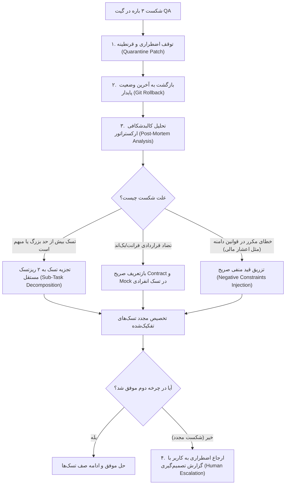

# مستندات معماری تیم مهندسی خودمختار Antigravity (Agent Swarm Spec)
**پروژه:** SmartOrders / CafeOS  
**نسخه:** 1.0.0 (بهینه‌سازی‌شده برای سقف مصرف توکن و پایداری عملیاتی)

---

## ۱. توپولوژی سیستم و مدل تعامل

در این معماری، ارتباط کاربر و ساب‌ایجنت‌ها کاملاً تفکیک شده است:
- **مرز تعامل کاربر (User Interaction Boundary):** کاربر تنها با **ارکستراتور ارشد (Master Orchestrator)** گفتگو می‌کند. کاربر هیچ‌گاه مستقیماً ساب‌ایجنت‌ها را مدیریت یا فراخوانی نمی‌کند.
- **حالت اجرای خودمختار (Autonomous Continuous Loop):** فرآیند توسعه در یک حلقه بدون وقفه اجرا می‌شود تا تمامی معیارهای پذیرش و تست‌ها با موفقیت پاس شوند.

```text
[ کاربر (زبان طبیعی / فارسی یا انگلیسی) ]
│
▼
┌────────────────────────────────────────────────────────┐
│               ارکستراتور ارشد (MASTER ORCHESTRATOR)    │
│ - ترجمه اهداف کلان کاربر به ریزتسک‌های ساختاریافته     │
│ - مدیریت دیتابیس حافظه فلت در .antigravity/state.json  │
│ - ارسال پاکت‌های تسک (Task Envelopes) به صف ایجنت‌ها   │
│ - یکپارچه‌سازی خروجی نهایی و گزارش موجز به کاربر        │
└───────┬──────────────┬──────────────┬──────────────┬───┘
        │              │              │              │
        ▼              ▼              ▼              ▼
┌──────────────┐┌──────────────┐┌──────────────┐┌──────────────┐
│ متخصص فرانت  ││ مهندس بک‌اند ││ دیتابیس و همگام││ ممیز و QA    │
│ frontend_dev ││ backend_dev  ││ db_sync_dev  ││ qa_gatekeeper│
└───────┬──────┘└───────┬──────┘└───────┬──────┘└───────┬──────┘
        │               │               │               │
        └───────────────┴───────┬───────┴───────────────┘
                                ▼
                  [ دروازه آزمون خودکار QA Gate ]
                                │
                        (حلقه تایید / بازگشت)
```

---

## ۲. گاردریل‌های بهینه‌سازی توکن و شیلد ضد محدودیت نرخ (Rate-Limit Shield)

1. **انزوای کامل کانتکست (Strict Context Isolation):**
   - ساب‌ایجنت‌ها هرگز کل تاریخچه مکالمه را به ارث نمی‌برند.
   - ورودی هر ساب‌ایجنت تنها یک پاکت تسک فشرده (`Task Envelope`) زیر ۱۵۰۰ توکن است.
2. **شیلد محدودیت نرخ و کنترل موازی‌سازی (`max_subagent_parallelism: 2`):**
   - برای پیشگیری قطعی از خطای سقف درخواست بر دقیقه (429 / TPM Caps)، حداکثر ۲ ساب‌ایجنت به صورت همزمان اجرا می‌شوند.
   - تاخیر کنترل‌شده حداقل ۱.۵ ثانیه بین فراخوانی‌های متوالی ایجنت‌ها اعمال می‌شود.
3. **پایگاه داده حافظه فلت (`.antigravity/state.json`):**
   - وضعیت لحظه‌ای و صف تسک‌ها روی دیسک ذخیره می‌شود تا در صورت پر شدن کانتکست یا نیاز به ریست سشن، ارکستراتور کار را دقیقاً از آخرین تسک ناتمام بدون ذره‌ای فراموشی یا اتلاف توکن از سر بگیرد.
4. **خلاصه‌سازی پلکانی گزارش‌ها (Progress Rollup):**
   - لاگ‌ها و جزئیات تکنیکی در سطح ایجنت‌ها فشرده شده و به کاربر تنها گزارش‌های مدیریتی، تاییدیه‌ها و خلاصه‌تغییرات (Diff) ارائه می‌شود.

---

## ۳. مشخصات و وظایف ایجنت‌های پنج‌گانه

### ۱. ارکستراتور ارشد (`orchestrator`)
- **نقش:** معمار ارشد سیستم و وکیل تام‌الاختیار کاربر
- **سقف توکن خروجی:** ۴,۰۰۰ توکن
- **وظایف اصلی:**
  - تحلیل اهداف کاربر و تبدیل آن به تسک‌های تک‌جمله‌ای همراه با قرارداد ورودی/خروجی.
  - به‌روزرسانی مداوم `.antigravity/state.json`.
  - نظارت بر بودجه توکن و تفکیک وظایف بدون فوروارد کردن لاگ‌های حجیم.
  - اعمال استراتژی ریکاوری بن‌بست در صورت شکست‌های پیاپی.

### ۲. متخصص فرانت‌اند (`frontend_dev`)
- **نقش:** مهندس ارشد کلاینت (React 19, TypeScript, Tailwind CSS v4)
- **قواعد اجرایی:**
  - تمرکز بر رویدادها، وضعیت کلاینت، چیدمان راست‌به‌چپ (Persian RTL) و جهش‌های خوش‌بینانه (Optimistic UI).
  - خواندن انحصاری فایل‌های قیدشده در پاکت تسک.
  - ذخیره پچ‌های کد در `.antigravity/patches/` و ارسال وضعیت `AWAITING_QA`.

### ۳. مهندس بک‌اند و سیستم‌ها (`backend_dev`)
- **نقش:** مهندس سرویس‌ها، ارتباطات شبکه و پل سخت‌افزاری
- **قواعد اجرایی:**
  - توسعه روت‌های API، سوکت‌ها و درایورهای سخت‌افزاری (چاپگرهای حرارتی ESC/POS).
  - رعایت اصل پایداری در برابر تکرار (Idempotency) و مدیریت خطا بدون توقف سرور.
  - شبیه‌سازی (Mock) سخت‌افزارهای فیزیکی در تست‌های محلی جهت تضمین اجرای بدون وقفه.

### ۴. مهندس پایگاه داده و همگام‌سازی آفلاین (`db_sync_dev`)
- **نقش:** معمار داده، موتور آفلاین IndexedDB و کنترل تراکنش‌ها
- **قواعد اجرایی:**
  - پیاده‌سازی تفکیک چندمستأجری با امنیت در سطح سطر (PostgreSQL RLS).
  - تضمین یکپارچگی صف محلی آفلاین با کلیدهای UUIDv4.
  - کنترل محاسبات مالی تومانی بدون اعشار و جبران کسری موجودی با ثبت رویداد حسابرسی.

### ۵. دروازه‌بان آزمون و ممیز کد (`qa_gatekeeper`)
- **نقش:** بازبین خودکار کد، امنیت و مهار رگرسیون
- **قواعد اجرایی:**
  - اجرای خودکار `npm run lint` (`tsc --noEmit`) و آزمون‌های واحد (`npm test`).
  - ردیابی نشت حافظه، Race Conditions و کدهای مرده.
  - صدور تصمیم:
    - **تایید (PASS):** علامت‌گذاری تسک با وضعیت `READY_FOR_MERGE` در `state.json`.
    - **رد (FAIL):** تولید لاگ خطا با استک‌تریس ساختاریافته و بازگشت به ایجنت مربوطه.

---

## ۴. پروتکل جامع مدیریت خطاهای پیاپی و رفع بن‌بست (Deadlock Recovery Protocol)

اگر یک ساب‌ایجنت در انجام یک تسک **۳ بار متوالی** توسط `qa_gatekeeper` رد شود، ارکستراتور بلافاصله پروتکل ۴ مرحله‌ای زیر را به صورت کاملاً خودکار اجرا می‌کند:



### شرح مراحل ریکاوری:

1. **قرنطینه و انجماد وضعیت (Patch Quarantine):**
   - تسک در فیلد `deadlocked_tasks` در فایل `.antigravity/state.json` قفل می‌شود.
   - پچ معیوب از پوشه پچ‌ها به `.antigravity/patches/quarantine/` منتقل می‌گردد.
2. **رول‌بک ایمن ورک‌اسپیس (Automated Rollback):**
   - تغییرات نیمه‌کاره فایل‌های مورد هدف تسک لغو و ورک‌اسپیس به وضعیت پایدار آخرین کامیت تمیز بازگردانده می‌شود تا آلودگی کدی به سایر تسک‌ها سرایت نکند.
3. **تحلیل کالبدشکافی و تجزیه هوشمند (Smart Decomposition):**
   - ارکستراتور علت شکست را دسته‌بندی می‌کند:
     - **اگر تسک پیچیده است:** آن را به دو تسک اتمیک خرد می‌کند (مثلاً: ابتدا ساخت تایپ‌ها و ماک‌های تست، سپس نوشتن تابع منطقی).
     - **اگر نقض قوانین دامنه است:** قید منفی بازدارنده قاطعانه به پاکت تسک اضافه می‌شود (`NEGATIVE_CONSTRAINT: Any floating point calculation or division will cause instant failure`).
4. **ارجاع شفاف به کاربر (Escalation to Human) فقط در شرایط بحرانی:**
   - اگر حتی پس از تجزیه تسک، بن‌بست برطرف نشود، ارکستراتور اجرای صف را متوقف کرده و گزارشی شامل:
     1. هدف تسک
     2. فایل‌های درگیر
     3. لاگ دقیق خطا
     4. دو یا سه گزینه پیشنهادی برای تصمیم‌گیری کاربر
     ارائه می‌دهد و منتظر پاسخ کاربر می‌ماند.

---

## ۵. ساختار فایل‌های پیکربندی در مخزن

```text
.antigravity/
├── state.json                  # پایگاه داده حافظه فلت (تسک‌ها، وضعیت‌ها، تاریخچه)
├── swarm_policy.json           # سیاست‌های محدودیت نرخ، توکن و ریکاوری بن‌بست
└── patches/
    ├── .gitkeep                # محل قرارگیری پچ‌های خروجی ایجنت‌ها
    └── quarantine/             # محل قرنطینه کدهای ردشده پس از ۳ بار شکست

docs/
├── AUTONOMOUS_SWARM_FACTORY.md # مستند فنی انگلیسی
└── SWARM_ARCHITECTURE_FA.md    # مستند جامع فارسی با پروتکل ریکاوری بن‌بست
```
